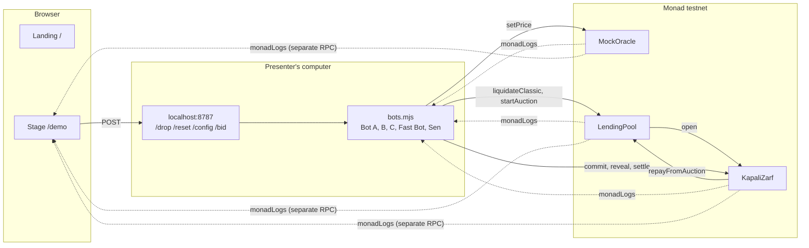

# Kapalı Zarf

**In a liquidation, the best bid should win, not the fastest bot.**

Kapalı Zarf ("sealed envelope" in Turkish) is a liquidation module for lending protocols. Instead
of selling a liquidatable position's collateral to the first bot at a fixed discount, it runs a
**sealed-bid, second-price (Vickrey) auction** over a few blocks. The winner pays the second-highest
bid; the debt is repaid and every dollar above it goes back to the borrower. It runs live on Monad
testnet, and a full round takes about **3 seconds**.

Monad Blitz Ankara v4 · October 24, 2026

| | |
| --- | --- |
| **Live site** | https://kapali-zarf.vercel.app |
| **Stage (demo)** | https://kapali-zarf.vercel.app/demo |
| **Replay mode (no chain needed)** | https://kapali-zarf.vercel.app/demo?mock=1 |
| **Network** | Monad testnet, chain ID 10143 |
| **Main contract** | [`KapaliZarf` 0xCf1a33B4…5D9e68F](https://testnet.monadvision.com/address/0xCf1a33B4f4A0726acF4686b7D00E707845D9e68F) |

The interface is in Turkish. Elif is the borrower in every example.

---

## Contents

1. [In 30 seconds](#in-30-seconds)
2. [For the judges: evidence per criterion](#for-the-judges-evidence-per-criterion)
3. [The problem](#the-problem)
4. [The solution: a sealed second-price auction](#the-solution-a-sealed-second-price-auction)
5. [Why on-chain, why Monad](#why-on-chain-why-monad)
6. [Results measured on testnet](#results-measured-on-testnet)
7. [How to watch and play the demo](#how-to-watch-and-play-the-demo)
8. [What is real and what is simplified for the demo](#what-is-real-and-what-is-simplified-for-the-demo)
9. [Architecture](#architecture)
10. [Deployed contracts](#deployed-contracts)
11. [Tests and CI](#tests-and-ci)
12. [Setup and running](#setup-and-running)
13. [Limitations and next steps](#limitations-and-next-steps)
14. [Built during the Blitz](#built-during-the-blitz)
15. [Team](#team)

---

## In 30 seconds

- **Problem:** When a position becomes liquidatable today, the first bot to arrive buys the
  collateral at 90% of its value. The 10% discount stays with the bot as a reward for speed; the
  borrower gets almost nothing back.
- **Solution:** The collateral goes into a sealed-bid auction lasting a few blocks. Bots seal their
  bids, then reveal them; the highest bid wins but pays the second-highest. The reserve price equals
  today's classic liquidation price, so the borrower never gets less than today.
- **Result (measured on Monad testnet):** 1 ETH collateral, 800 $ debt, ETH falls from 1000 to 900 $.

| | Classic liquidation | Kapalı Zarf |
| --- | --- | --- |
| Who takes the collateral | The fastest bot, in 1 block | The highest bid (890), paying the second price |
| Price paid | 810 $ | 885 $ |
| **Returned to the borrower** | **10 $** | **85 $** |
| Time | 1 block | 10 blocks, ≈ 3.1 s |

---

## For the judges: evidence per criterion

| Criterion | Where to see it |
| --- | --- |
| **Built at the event** | All code was written on October 24; nothing was prepared before the event. The commit history starts at 12:11; see [Built during the Blitz](#built-during-the-blitz). |
| **Deployed on Monad** | Five contracts on Monad testnet, listed [below](#deployed-contracts) and in [`shared/addresses.json`](shared/addresses.json). Deploy record: [`broadcast/Deploy.s.sol/10143/`](broadcast/Deploy.s.sol/10143). |
| **Honest pitch** | The headline claim ("85 $ instead of 10 $ back to the borrower, in ≈ 3 s") can be checked against real testnet transactions: [measured round](#results-measured-on-testnet). Everything simplified for the demo is listed [here](#what-is-real-and-what-is-simplified-for-the-demo). |
| **Execution** | Contracts, bots and the stage page work end to end on testnet; 39 Foundry tests (including fuzzing) and GitHub Actions CI. |
| **On-chain necessity · Monad fit** | The chain is the mechanism here, not a payment rail: sealing, locking, revealing and the second price are all enforced on-chain. A sealed-bid auction is only usable with short blocks: ≥ 24 s on Ethereum, ≈ 3 s on Monad. [Details](#why-on-chain-why-monad). |
| **Problem & promise** | A clear user: the borrower and the lending protocol. Designed as a module that can plug into any lending protocol on Monad. |
| **Originality** | The Vickrey auction, published in 1961 and awarded the Nobel Prize in Economics in 1996, stayed mostly on paper for 30 years: someone had to be trusted to open the envelopes. Here code opens them, and the round ends within a few blocks. |

---

## The problem

In lending protocols (Aave- or Compound-style), a position becomes liquidatable once its collateral
value falls below a set ratio of its debt. Today's model:

1. The price falls and liquidation bots race to get into the same block.
2. **The fastest one** buys all of the collateral at a fixed discount (90% of value in our example).
3. The debt is repaid and the small remainder goes back to the borrower.

In the example, Elif borrowed 800 $ against 1 ETH of collateral. ETH falls from 1000 $ to 900 $:

- The fast bot buys collateral worth 900 $ for **810 $**.
- The 800 $ debt is repaid and Elif gets **10 $** back.
- The **90 $** discount stays with the bot, because bots compete on speed, not on price.

That money is the borrower's loss; the speed race also produces gas wars and MEV.

---

## The solution: a sealed second-price auction

A liquidatable position is sent to `KapaliZarf` through `LendingPool.startAuction`. A round has three
steps:

| Step | What happens | Duration (4 + 4 blocks) |
| --- | --- | --- |
| **1. Seal** | Each bidder writes `keccak256(id, amount, salt, address)` on-chain and **locks the same amount (the cap)**. Neither the hash nor the lock reveals the bid. | 4 blocks ≈ 1.2 s |
| **2. Reveal** | Bidders disclose amount and salt; the contract checks the hash. The amount must lie between the reserve and the cap. | 4 blocks ≈ 1.2 s |
| **3. Settle** | The highest bid wins and pays the **second-highest bid** (the reserve if it is the only bid). The debt is repaid, the rest goes to the borrower, the collateral to the winner. | 1 transaction |

**Rules**

- **Reserve = classic price** (90% of collateral value). The borrower never gets less than under
  today's model.
- **Cap = market value of the collateral.**
- **Ties:** the bid revealed first wins and pays that amount.
- **Unrevealed bids** are unlocked at settlement; no penalty.
- **No bids** (`NoBids`): anyone can liquidate at the reserve price with `fallbackLiquidate`. A
  liquidation can never get stuck.
- **`settle` never reverts.** If the price is below the debt, the amount paid is repaid and the
  shortfall is recorded as `badDebt` in the pool (the shared `Split` library makes underflow
  impossible).
- **No double liquidation:** a position in an auction (`inAuction`) cannot be liquidated the classic
  way or sent to a second auction.
- At most 8 bidders (bounded `settle` loop); locked balances cannot be withdrawn.

**Why does everyone bid their true value?** Under the second-price rule, what you pay depends on
your rivals' bids, not on your own. Bidding higher can make you win at more than the collateral is
worth to you; bidding lower doesn't change the price you pay, it only lowers your chance of winning.
So the price moves toward true value, and the difference stays with the borrower.

**Who wins**

| | Classic | Kapalı Zarf |
| --- | --- | --- |
| Borrower | 10 $ | 85 $ (ETH at 900) |
| Pool (sharp drop, ETH at 850) | 35 $ bad debt | 0 $ bad debt |
| Liquidator | Gas wars, front-running | Competes on price; a losing bid is unlocked |

---

## Why on-chain, why Monad

**It needs the chain because:**

- A sealed bid is only worth something if nobody, organizer included, can open the envelopes early.
  The hash commitment and its check live in the contract; the reveal order and the second price are
  decided by code anyone can audit.
- Collateral, payment, debt repayment and the refund to the borrower happen in one atomic
  transaction (`settle`).
- Bidders' funds are locked in the contract: the winner cannot walk away from paying, and losers get
  their money back.

**It needs Monad because a sealed-bid auction needs two separate windows:** bidding and revealing.
If the price moves again during that time, the auction loses its meaning.

| | Ethereum L1 | Monad testnet (measured) |
| --- | --- | --- |
| Block time | 12 s | ≈ 0.31 s |
| Lower bound for the two windows | ≥ 24 s | 4 + 4 blocks ≈ 2.5 s |
| Price drop to settlement | minutes | 10 blocks, ≈ 3.1 s |

**Monad-specific engineering** (what makes these numbers possible):

- **`monadLogs` / `monadNewHeads`:** the bots hear events before the block is voted, about 1 s
  earlier than with the standard subscriptions ([`bots/ws.mjs`](bots/ws.mjs)). If the subscription
  drops, they continue with narrow `eth_getLogs` polling.
- **Sending one block early:** a reveal sent when the chain shows the `commitEnd` block lands in the
  next block at the earliest, which is the first block of the reveal window. So the bots send before
  the window closes.
- **Fixed gas limits:** Monad charges the gas limit, not the gas used. Limits are pinned from test
  measurements, which also removes an `eth_estimateGas` round trip from every transaction.
- **Local signing, one call, no waiting for receipts:** nonces are tracked locally, each transaction
  goes out with a single `eth_sendRawTransaction`, and the outcome arrives as an event.
- **Reserve balance rule:** every demo wallet keeps at least 1 MON; transient "insufficient balance"
  answers are retried.
- A shared per-process rate limiter keeps the bots under the public RPC's 15 requests/s limit.

---

## Results measured on testnet

All numbers are from Monad testnet on October 24, 2026, taken from the bot process logs and the
chain.

**4 + 4 block windows** (the current deployment). Every bot transaction landed in the block right
after the one it was sent at.

| Step | Block | After sending | Transaction |
| --- | --- | --- | --- |
| Price drop (ETH 1000 → 900) | 73786808 | +2 blocks | [0x9eca…515c](https://testnet.monadvision.com/tx/0x9ecabd45095ca3e694474efbacbeb10d21e25d5ad50f293cf728b6cb6330515c) |
| Classic liquidation: Fast Bot pays 810, Elif gets 10 | 73786809 | +1 block | [0x1fb6…8f92](https://testnet.monadvision.com/tx/0x1fb6ba43b3fdc38562895b9f4083710d12bc37461fa8fc51afc0e2a9bc9f8f92) |
| Auction starts | 73786809 | +1 block | [0xd1f5…7ac2](https://testnet.monadvision.com/tx/0xd1f53b63645af7d991a0545b0d3a453e9b83b15ca3ddd375d4179ca8c07e7ac2) |
| Three sealed bids | 73786810 | +1 block | |
| Three reveals: 890, 885, 870 | 73786814 | +1 block | |
| Settlement: Bot A wins, pays 885, Elif gets 85 | 73786818 | +1 block | [0x273c…d39e](https://testnet.monadvision.com/tx/0x273cf2c88c01161468f115f031b038ca8cb9b9627aea2bbaecfe968021c4d39e) |

**Choosing the windows:** the first deployment used 8 + 8 blocks (roadmap: start safe, measure,
shorten). In that round, transactions landed within 1–2 blocks and 6 blocks went unused; the round
took 19 blocks, ≈ 6.1 s. The windows were cut to 4 + 4: a 2-block margin remains and the round takes
10 blocks, ≈ 3.1 s. Block time measured ≈ 0.31 s in both rounds.

**Other scenarios** (played live from the stage page):

- With a sealed "Sen" ("you") bid of 892 $ and Bot B at a 0.5% margin bidding 895: Bot B won, paid the
  second price of 892, and Elif got 92 $ back (+82 $ over classic).
- In the first 4 + 4 attempt, a bot bug (salt files from the previous deployment were reused; fixed)
  meant no bid could be revealed. The round ended with `NoBids` and Bot C liquidated at the reserve
  price with `fallbackLiquidate`: the fallback path was tested on testnet, unintentionally but for
  real.

---

## How to watch and play the demo

| URL | What's there | Who can use it |
| --- | --- | --- |
| [`/`](https://kapali-zarf.vercel.app) | Landing page: the problem, Vickrey's story, the three steps, a **try-your-own-bids** calculator, why Monad, contract links | Everyone |
| [`/demo`](https://kapali-zarf.vercel.app/demo) | The stage, live mode: real testnet events streamed with `monadLogs` | Everyone can watch; the drop and reset need the bot process (see below) |
| [`/demo?mock=1`](https://kapali-zarf.vercel.app/demo?mock=1) | Replay mode: the same screen, with the round computed in the browser by the contract's rules | Everyone, no chain and no bots needed |

**On the stage page**

- At the top, the large ETH price and the **"ETH %10 düştü"** ("ETH fell 10%") button.
- Classic liquidation on the left, Kapalı Zarf on the right: two identical positions with a health
  factor gauge.
- In the right column, envelopes appear sealed and open during the reveal window; the winner is
  highlighted, "paid: second bid" is shown, the seal is stamped, and the refund flies into Elif's
  card.
- The bottom strip shows the **difference** (`AuctionSettled.refund − ClassicLiquidated.refund`), the
  elapsed time and an explorer link for every step. Every number on screen comes from on-chain
  events.

**Control panel** (on the right, toggle with `P`)

| Section | What it does |
| --- | --- |
| Senaryo (scenario) | Drop of 7 / 10 / 15 / 20% (930 / 900 / 850 / 800 $). At 15% and 20% the sale price no longer covers the debt; the bottom strip then also compares the pool's bad debt. |
| Botların stratejisi (bot strategies) | Each bot's margin (0–10%) and an on/off switch. With every bot off, the round gets no bids and the fallback path plays. |
| Sen de teklif ver (place your own bid) | Pick an amount between reserve and cap and seal it: it opens as the "Sen" envelope in the next auction. |
| Canlı akış / Geçmiş (live feed / history) | Every event of the round with its block number and explorer link; a table of finished rounds, with ▶ to replay any round at x2.5 slow motion. |

Hovering a term (health factor, reserve, cap, sealed, second price, bad debt) shows an explanation.
Keys: `Space` price drop, `R` reset, `P` panel, `Esc` leave the replay.

**Why does live mode need the bot process?** The stage page never writes to the chain, and the owner
key never enters the browser. The price drop, reset, strategies and the "Sen" bid go to the
`localhost:8787` endpoint on the computer running the bots. So anyone who opens the deployed page
watches the on-chain round live, but the drop button is only active on the machine running the bot
process. When the bot process is not reachable the button is grey; `?mock=1` then offers the same
experience without the chain.

---

## What is real and what is simplified for the demo

| Component | Status |
| --- | --- |
| `KapaliZarf` (sealing, revealing, second price, refund, fallback) | **Real**, running on testnet |
| `LendingPool` (positions, health factor, classic liquidation, sending to auction, bad debt) | **Real**, but simple: one collateral type, no interest, the whole collateral is sold |
| Bots (listening, signing, sending, timing) | **Real**, sending real transactions |
| Bot bids | Not a real market valuation: `value × (1 − margin)`, default margins 1.11% / 1.66% / 3.33% |
| `MockOracle` | **For the demo.** The owner sets the ETH price by hand; it's the only way to say "ETH fell 10%" on stage. A real protocol would use Pyth or Chainlink. |
| `MockUSD`, `MockWETH` | **For the demo.** Anyone can mint; testnet only, no real value. |
| Stage page, live mode | Real events; elapsed time shown as block count × 0.31 s (the measured average) |
| `?mock=1` and the calculator on the landing page | Don't touch the chain; apply the contract's rules in the browser |
| Numbers on the landing page (10 → 85 $, ≈ 3.1 s, 10 blocks) | Written from the measured round, not read live |

---

## Architecture



Solid arrows are transactions, dashed arrows are event streams. The bot process and the stage page
use different RPC endpoints.

| Layer | Technology | Files |
| --- | --- | --- |
| Contracts | Solidity 0.8.28, Foundry, OpenZeppelin (`SafeERC20`, `ReentrancyGuard`, `Ownable`) | [`src/`](src) |
| Bots | Node 22, viem, raw WebSocket | [`bots/`](bots) |
| Stage and landing | Vite, React 19, TypeScript, viem, framer-motion | [`web/`](web) |
| Shared contract | Addresses and ABIs | [`shared/`](shared) |

**Events** (the stage page is driven only by these)

```solidity
event PriceUpdated(uint256 price);
event ClassicLiquidated(address indexed borrower, address indexed liquidator, uint256 price, uint256 debtRepaid, uint256 refund);
event AuctionStarted(bytes32 indexed id, address indexed borrower, uint256 collateral, uint256 debt, uint256 value, uint256 reservePrice, uint64 commitEnd, uint64 revealEnd);
event BidCommitted(bytes32 indexed id, address indexed bidder);
event BidRevealed(bytes32 indexed id, address indexed bidder, uint256 amount);
event AuctionSettled(bytes32 indexed id, address indexed winner, uint256 price, uint256 debtRepaid, uint256 refund);
event NoBids(bytes32 indexed id);
event FallbackLiquidated(bytes32 indexed id, address indexed liquidator, uint256 price, uint256 refund);
```

**Repository layout**

```text
src/                 KapaliZarf, LendingPool, Split, MockOracle, MockUSD, MockWETH
test/                Base.t.sol (shared setup), KapaliZarf.t.sol, LendingPool.t.sol
script/Deploy.s.sol  deploys the five contracts, writes shared/addresses.json
bots/
  config.mjs         RPC, rate limiter, fixed gas limits, locally signing sender
  ws.mjs             monadLogs / monadNewHeads subscriptions, HTTP polling fallback
  bots.mjs           all bots in one process + localhost:8787
  drop-server.mjs    /health /drop /reset /config /bid
  reset.mjs          puts the demo back to its starting state
  wallets.mjs        creates the demo wallets
  drop.mjs           drops the price from the terminal
  export-abi.mjs     copies the ABIs to shared/abi/
web/                 landing (/) and stage (/demo)
shared/              addresses.json (deploy output), abi/
broadcast/           testnet deploy records
```

---

## Deployed contracts

Monad testnet (chain ID 10143), deploy block 73786456, windows of 4 + 4 blocks.

| Contract | Address | Role |
| --- | --- | --- |
| KapaliZarf | [`0xCf1a33B4f4A0726acF4686b7D00E707845D9e68F`](https://testnet.monadvision.com/address/0xCf1a33B4f4A0726acF4686b7D00E707845D9e68F) | Sealed bids, reveals, second price, refund, fallback |
| LendingPool | [`0x09F2136e0412562F68f96E06788de495B03fbEAF`](https://testnet.monadvision.com/address/0x09F2136e0412562F68f96E06788de495B03fbEAF) | Positions, classic liquidation, starting auctions, bad debt |
| MockOracle | [`0xcc3a537f30f65ee36D14c4f7e376612448C99d19`](https://testnet.monadvision.com/address/0xcc3a537f30f65ee36D14c4f7e376612448C99d19) | Demo ETH price |
| MockUSD | [`0xcb9A73420F9ACb5076CEd388857E2F8A91a5CCcF`](https://testnet.monadvision.com/address/0xcb9A73420F9ACb5076CEd388857E2F8A91a5CCcF) | Debt token (mUSD) |
| MockWETH | [`0x74D7F8e46549b5C8Fe24119B282B6eEA1fde4CEC`](https://testnet.monadvision.com/address/0x74D7F8e46549b5C8Fe24119B282B6eEA1fde4CEC) | Collateral token (mWETH) |

The demo wallets (the two Elifs, the bots, "Sen") are in [`shared/addresses.json`](shared/addresses.json).

---

## Tests and CI

```bash
forge test -vv --gas-report
```

39 tests (including fuzzing), using the example's numbers (1 ETH collateral, 800 debt, ETH 1000 → 900):

| Area | Tests |
| --- | --- |
| The example | `test_SecondPriceAuction_ElifGets85`, `test_ClassicLiquidation_ElifGets10`, `test_ReserveEqualsClassicPrice` |
| Pricing rules | `test_SingleBidPaysReserve`, `test_TieGoesToFirstRevealAtThatPrice`, `testFuzz_WinnerPaysSecondHighest` (512 runs; the borrower never gets less than classic, and the module is always backed by its balances) |
| Price below the debt | `test_SettleBelowDebt_NeverReverts`, `test_ClassicBelowDebt_RecordsBadDebt` |
| No bids | `test_NoBidsThenFallbackAtClassicPrice`, `test_CommittedButNobodyRevealed_NoBidsAndUnlocked`, `test_UnrevealedUnlocked` |
| Sealing | `test_HashMatchesOffchain` (against a hash produced by viem), wrong salt, different amount, copying another bidder's hash |
| Windows | early reveal, late commit, early and double settlement, phase transitions |
| Balances and limits | locked balance cannot be withdrawn, insufficient balance, the 8-bidder limit, `settle` gas with 8 bidders |
| Pool and access | no double liquidation, a healthy position cannot be liquidated, only the pool opens auctions, only the owner moves the price |

[GitHub Actions](.github/workflows/test.yml) runs `forge fmt --check`, `forge build`, `forge test`
and the stage page's lint + build on every push. At start-up the bots compare their local hash
encoding with the contract's `hashBid`; if they differ, the bots refuse to start.

---

## Setup and running

**Requirements:** Foundry, Node 22+.

```bash
npm install
npm --prefix web install
forge build
forge test
```

**1. Environment.** Copy `.env.example` to `.env`:

- `MONAD_TESTNET_RPC`, `MONAD_TESTNET_WSS`: the public QuickNode endpoints are filled in by default.
- `DEPLOYER_PK`: a wallet funded from the faucet (the owner). 15–20 MON recommended: the deploy
  costs ≈ 1 MON, each demo wallet gets 1.5 MON, and Monad keeps ≈ 10 MON in reserve on the owner.

**2. Demo wallets** (two Elifs, four bots, "Sen"):

```bash
npm run wallets
```

**3. Deploy** (writes `shared/addresses.json` and `shared/abi/`):

```bash
npm run deploy
```

**4. Before every rehearsal:**

```bash
npm run reset
npm run bots
npm run web
```

`reset` sets the price back to 1000, tops up gas where needed, funds the bots, closes any unfinished
auction and opens the two identical positions (health factor 1.06); it takes ≈ 10 s. `bots` keeps
running. Press the button on stage, or from the terminal:

```bash
npm run drop
```

A different RPC endpoint than the bots is recommended for the stage page (`web/.env.local`):

```bash
VITE_RPC_URL=https://rpc-testnet.monadinfra.com
VITE_WSS_URL=wss://rpc-testnet.monadinfra.com
```

**Running locally (Anvil):**

```bash
anvil --block-time 1
```

Put `RPC_URL=http://127.0.0.1:8545`, `WS_URL=ws://127.0.0.1:8545` and Anvil's keys
(`DEPLOYER_PK`, `ELIF_KLASIK_PK`, …, `GUEST_PK`) in a separate `.env.anvil`, then:

```bash
set -a; . ./.env.anvil; set +a
forge script script/Deploy.s.sol --rpc-url $RPC_URL --broadcast
ENV_FILE=.env.anvil npm run reset
ENV_FILE=.env.anvil npm run bots
npm run web          # http://localhost:5173/demo?chain=31337
```

<details>
<summary><b>Settings and gas limits</b></summary>

| Variable | Default | Purpose |
| --- | --- | --- |
| `COMMIT_BLOCKS`, `REVEAL_BLOCKS` | 8, 8 (4, 4 in `.env`) | Window lengths, read at deploy time |
| `MONAD_TESTNET_WSS`, `WS_URL` | derived from the RPC | The bots' WebSocket endpoint |
| `RPC_RPS` | 12 | HTTP request limit per process |
| `DROP_PORT` | 8787 | Stage endpoint |
| `DROP_PRICE` | 900 | Default price for `npm run drop` |
| `PRIORITY_GWEI` | 2 | Fee: latest base fee × 2 + this tip |
| `MIN_GAS_MON`, `GAS_TOPUP_MON` | 1, 1.5 | A wallet below this balance gets this much MON |
| `OWNER_RESERVE_MON` | 10 | MON balance the owner never goes below |
| `EXPLORER_TX_URL` | MonadVision testnet | Transaction links in the logs |
| `RPC_URL`, `ENV_FILE` | — | To try another chain (Anvil) |

Stage page: `VITE_RPC_URL`, `VITE_WSS_URL`, `VITE_DROP_URL` (default `http://localhost:8787`),
`VITE_EXPLORER_TX_URL`, `VITE_CHAIN_ID`, `VITE_BLOCK_SECONDS` (default 0.31).

Gas limits ([`bots/config.mjs`](bots/config.mjs)): `forge --gas-report` maximum + 21k, × 1.5.

| Function | Limit |
| --- | --- |
| setPrice | 80,000 |
| startAuction | 450,000 |
| commit | 215,000 |
| reveal | 220,000 |
| settle (8 bidders) | 380,000 |
| liquidateClassic | 195,000 |
| fallbackLiquidate | 340,000 |

</details>

---

## Limitations and next steps

**Known limitations**

- The price feed is set by hand for the demo; the tokens are mock tokens.
- The pool is simple: one collateral type, no interest, no partial liquidation; the whole collateral
  is sold.
- Bidders lock the full cap; this is not capital efficient.
- The number of bidders is visible on-chain (the amounts are not).
- If the price moves during the auction (≈ 3 s), the bidders carry that risk; the collateral value is
  fixed when the auction starts.
- The stage page's drop and reset buttons need the computer running the bots.
- The contract sources are not yet verified on the explorer, and the contracts are not audited.

**Next steps**

- A real oracle (Pyth / Chainlink) and integration as a module into a lending protocol on Monad.
- Partial liquidation and multiple collateral types.
- A smaller, collateralised lock instead of the full cap; designs that hide the number of bids.
- A liquidator SDK that lets AI agents set bidding strategies.
- Moving the bot process to a hosted service and opening the drop button to authorised users.

---

## Built during the Blitz

**No code, idea or project was prepared before the event.** All code was written during Monad
Blitz Ankara v4 on October 24, 2026; apart from standard libraries (OpenZeppelin, forge-std, viem,
React), no existing code was used. AI-assisted coding tools were used during development.

| Time | What was built |
| --- | --- |
| 12:11 | First commit: contracts, tests, deploy script, bots |
| 12:20 | CI (fmt, build, test) |
| 12:31–12:36 | Frozen event signatures, `Split` and bad debt, removal of the unrevealed-bid penalty, split tests, `shared/` outputs |
| 12:42 | Event-driven bots: `monadLogs`, local signing, fixed gas, `localhost:8787` |
| 12:51–12:55 | Stage page (Vite + React), end-to-end run on Anvil |
| 13:06–13:11 | Monad testnet deploy (8 + 8), first live round, redeploy with 4 + 4 based on the measurements |
| 13:14 | Measured block time (0.31 s) on the stage |
| 13:23–13:35 | Control panel: scenario, bot strategies, "Sen" bid, live feed, history, slow-motion replay |
| 13:40 | Landing page; the stage moved to `/demo` |
| 14:27–15:43 | Logo, Vickrey's story and the Nobel medal on the landing page |

Every step can be seen in the [commit history](https://github.com/iremsaniyebaran/kapali-zarf/commits/main).

---

## Team

| | GitHub | LinkedIn |
| --- | --- | --- |
| **İrem Saniye Baran** | [@iremsaniyebaran](https://github.com/iremsaniyebaran) | [linkedin.com/in/iremsaniyebaran](https://www.linkedin.com/in/iremsaniyebaran/) |
| **Eyüp Efe Karakoca** | [@SweetieBirdX](https://github.com/SweetieBirdX) | [linkedin.com/in/eyupefekarakoca](https://www.linkedin.com/in/eyupefekarakoca/) |

License: MIT
