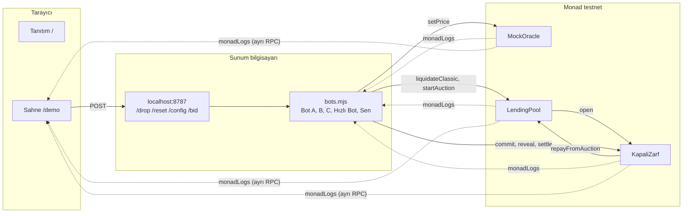

# Kapalı Zarf

**Likidasyonda en hızlı bot değil, en iyi teklif kazanır.**

Kapalı Zarf, borç protokolleri için bir likidasyon modülü. Likide edilecek teminatı ilk gelen bota
sabit indirimle satmak yerine birkaç bloğluk **mühürlü, ikinci fiyat (Vickrey) açık artırmasına**
sokuyor. Kazanan ikinci en yüksek teklifi öder; borç kapanır, üstündeki her dolar borçluya döner.
Monad testnet'te canlı çalışıyor: bütün tur yaklaşık **3 saniye**.

Monad Blitz Ankara v4 · 24 Ekim 2026

| | |
| --- | --- |
| **Canlı site** | https://kapali-zarf.vercel.app |
| **Sahne (demo)** | https://kapali-zarf.vercel.app/demo |
| **Kayıt modu (zincirsiz yedek)** | https://kapali-zarf.vercel.app/demo?mock=1 |
| **Ağ** | Monad testnet, chain ID 10143 |
| **Ana kontrat** | [`KapaliZarf` 0xCf1a33B4…5D9e68F](https://testnet.monadvision.com/address/0xCf1a33B4f4A0726acF4686b7D00E707845D9e68F) |

---

## İçindekiler

1. [30 saniyede](#30-saniyede)
2. [Jüri için: kriterlerin kanıtı](#jüri-için-kriterlerin-kanıtı)
3. [Sorun](#sorun)
4. [Çözüm: mühürlü ikinci fiyat](#çözüm-mühürlü-ikinci-fiyat)
5. [Neden zincir, neden Monad](#neden-zincir-neden-monad)
6. [Testnet'te ölçülen sonuçlar](#testnette-ölçülen-sonuçlar)
7. [Demo nasıl izlenir ve denenir](#demo-nasıl-izlenir-ve-denenir)
8. [Neler gerçek, neler demo için basitleştirildi](#neler-gerçek-neler-demo-için-basitleştirildi)
9. [Mimari](#mimari)
10. [Deploy edilen kontratlar](#deploy-edilen-kontratlar)
11. [Testler ve CI](#testler-ve-ci)
12. [Kurulum ve çalıştırma](#kurulum-ve-çalıştırma)
13. [Sınırlamalar ve sonraki adımlar](#sınırlamalar-ve-sonraki-adımlar)
14. [Blitz sırasında yapılanlar](#blitz-sırasında-yapılanlar)
15. [Ekip](#ekip)

---

## 30 saniyede

- **Sorun:** Bugün bir pozisyon likide olduğunda teminatı ilk gelen bot değerinin %90'ına alır.
  Aradaki %10 hıza ödenen ödül olarak botta kalır; borçlu neredeyse hiçbir şey geri almaz.
- **Çözüm:** Teminat birkaç bloğluk kapalı zarf açık artırmasına girer. Botlar teklifini mühürler,
  sonra açar; en yüksek teklif kazanır ama ikinci en yüksek teklifi öder. Taban fiyat bugünkü klasik
  fiyata eşit, yani borçlu hiçbir zaman bugünkünden az almaz.
- **Sonuç (Monad testnet'te ölçüldü):** 1 ETH teminat, 800 $ borç, ETH 1000 → 900 $.

| | Klasik likidasyon | Kapalı Zarf |
| --- | --- | --- |
| Teminatı alan | En hızlı bot, 1 blokta | En yüksek teklif (890), ikinci fiyatı öder |
| Ödenen | 810 $ | 885 $ |
| **Borçluya dönen** | **10 $** | **85 $** |
| Süre | 1 blok | 10 blok, ≈ 3,1 sn |

---

## Jüri için: kriterlerin kanıtı

| Kriter | Nerede görülür |
| --- | --- |
| **Etkinlikte yapıldı** | Bütün kod 24 Ekim'de yazıldı; etkinlikten önce hazırlanmış kod yok. Commit geçmişi 12:11'den başlıyor, ayrıntı [Blitz sırasında yapılanlar](#blitz-sırasında-yapılanlar)'da. |
| **Monad'da deploy** | Beş kontrat Monad testnet'te, adresler [aşağıda](#deploy-edilen-kontratlar) ve [`shared/addresses.json`](shared/addresses.json)'da. Deploy kaydı: [`broadcast/Deploy.s.sol/10143/`](broadcast/Deploy.s.sol/10143). |
| **Dürüst pitch** | Ana iddia ("borçluya 10 $ yerine 85 $, ≈ 3 sn") testnet'teki gerçek işlemlerle doğrulanabilir: [ölçülen tur](#testnette-ölçülen-sonuçlar). Demo için basitleştirilen her şey [burada](#neler-gerçek-neler-demo-için-basitleştirildi) yazıyor. |
| **Execution** | Kontratlar, botlar ve sahne sayfası testnet'te uçtan uca çalışıyor; 39 Foundry testi (fuzz dahil) ve GitHub Actions CI. |
| **On-chain gereklilik · Monad uyumu** | Zincir burada ödeme kanalı değil, mekanizmanın kendisi: mühür, kilit, açma ve ikinci fiyat zincirde doğrulanır. Kapalı zarf ancak kısa bloklarla kullanılabilir: Ethereum'da ≥ 24 sn, Monad'da ≈ 3 sn. [Ayrıntı](#neden-zincir-neden-monad). |
| **Problem ve vaat** | Net kullanıcı: borç alan kişi ve borç protokolü. Monad'daki herhangi bir borç protokolüne takılabilecek bir modül olarak tasarlandı. |
| **Özgünlük** | 1961'de yayımlanan, 1996'da Nobel alan Vickrey açık artırması 30 yıl çoğunlukla kâğıtta kaldı: zarfları açan kişiye güvenmek gerekiyordu. Burada zarfları kod açıyor ve tur bir bloğun birkaç katında bitiyor. |

---

## Sorun

Borç protokollerinde (Aave, Compound benzeri) teminat değeri borcun belli bir oranının altına düşünce
pozisyon likide edilebilir hale gelir. Bugünkü model:

1. Fiyat düşer, likidasyon botları aynı bloğa girmek için yarışır.
2. **En hızlısı** teminatın tamamını sabit indirimle alır (bizim örnekte değerin %90'ı).
3. Borç kapanır, kalan küçük fark borçluya döner.

Örnekte Elif 1 ETH teminatla 800 $ borç almış. ETH 1000 $'dan 900 $'a düşüyor:

- Hızlı bot 900 $ değerindeki teminatı **810 $**'a alır.
- 800 $ borç kapanır, Elif'e **10 $** döner.
- **90 $**'lık indirim, rekabet fiyatla değil hızla yapıldığı için botta kalır.

Bu para borçlunun kaybı; ayrıca hız yarışı gas savaşı ve sıra kapma (MEV) üretir.

---

## Çözüm: mühürlü ikinci fiyat

Likide edilebilir pozisyon `LendingPool.startAuction` ile `KapaliZarf`'a gönderilir. Tur üç adım:

| Adım | Ne olur | Süre (4 + 4 blok) |
| --- | --- | --- |
| **1. Mühürle** | Her teklif veren `keccak256(id, tutar, salt, adres)` hash'ini zincire yazar ve **aynı tutarı (tavanı) kilitler**. Ne hash ne kilit tutarı ele vermez. | 4 blok ≈ 1,2 sn |
| **2. Aç** | Teklif veren tutarı ve salt'ı açıklar, kontrat hash'i doğrular. Tutar taban–tavan aralığında olmalı. | 4 blok ≈ 1,2 sn |
| **3. Sonuçlan** | En yüksek teklif kazanır, **ikinci en yüksek teklifi** öder (tek teklifte taban fiyat). Borç kapanır, üstü borçluya döner, teminat kazanana gider. | 1 işlem |

**Kurallar**

- **Taban = klasik fiyat** (teminat değerinin %90'ı). Borçlu hiçbir zaman bugünkü modelden az almaz.
- **Tavan = teminatın piyasa değeri.**
- **Eşitlikte** önce açıklayan kazanır ve o tutarı öder.
- **Açıklanmayan teklif** sonuçlandırmada kilidinden çıkar; ceza yok.
- **Teklif gelmezse** (`NoBids`) herkes taban fiyattan `fallbackLiquidate` edebilir. Likidasyon hiçbir
  zaman takılı kalmaz.
- **`settle` hiçbir durumda revert etmez.** Fiyat borcun altındaysa ödenen kadar borç kapanır, eksik
  kısım havuzda `badDebt` olarak kaydedilir (ortak `Split` kütüphanesi taşmayı imkânsız kılar).
- **Çifte likidasyon yok:** açık artırmadaki pozisyon (`inAuction`) klasik yolla ya da ikinci kez
  açık artırmaya gönderilemez.
- En fazla 8 teklif veren (`settle` döngüsü sınırlı); kilitli bakiye çekilemez.

**Neden herkes gerçek değerini yazar?** İkinci fiyat kuralında ödenen fiyat kendi teklifine değil,
rakiplerin teklifine bağlıdır. Daha yükseğini yazmak, değerinden pahalıya kazanmaya yol açabilir;
daha düşüğünü yazmak ödenecek fiyatı değiştirmez, yalnızca kazanma şansını azaltır. Böylece fiyat
gerçek değere yaklaşır ve fark borçluya kalır.

**Kim kazanır**

| | Klasik | Kapalı Zarf |
| --- | --- | --- |
| Borçlu | 10 $ | 85 $ (ETH 900'de) |
| Havuz (sert düşüş, ETH 850) | 35 $ kötü borç | 0 $ kötü borç |
| Likidatör | Gas savaşı, sıra kapma | Fiyatla rekabet; kaybeden teklifin parası kilitten çıkar |

---

## Neden zincir, neden Monad

**Zincir şart, çünkü:**

- Mühürlü teklifin değeri, kimsenin (organizatör dahil) zarfları önceden açamamasında. Hash taahhüdü
  ve doğrulama kontratta; açılış sırası ve ikinci fiyat herkesin denetleyebileceği kodla belirleniyor.
- Teminat, ödeme, borç kapatma ve borçluya iade tek bir atomik işlemde (`settle`) gerçekleşiyor.
- Teklif verenlerin parası kontratta kilitli; kazanan ödemekten kaçamaz, kaybeden parasını geri alır.

**Monad şart, çünkü kapalı zarf iki ayrı pencere ister:** teklif ve açıklama. Fiyat bu sürede yeniden
oynarsa açık artırma anlamını yitirir.

| | Ethereum L1 | Monad testnet (ölçülen) |
| --- | --- | --- |
| Blok süresi | 12 sn | ≈ 0,31 sn |
| İki pencere için alt sınır | ≥ 24 sn | 4 + 4 blok ≈ 2,5 sn |
| Fiyat düşüşünden sonuca | dakikalar | 10 blok, ≈ 3,1 sn |

**Monad'a özgü mühendislik** (bu sayıları mümkün kılan kısım):

- **`monadLogs` / `monadNewHeads`:** Botlar event'leri blok oylanmadan, standart aboneliklerden ~1 sn
  önce duyuyor ([`bots/ws.mjs`](bots/ws.mjs)). Abonelik düşerse dar aralıklı `eth_getLogs` ile devam.
- **Bir blok erken gönderim:** Zincir `commitEnd` bloğunu gösterdiğinde gönderilen açıklama en erken
  bir sonraki bloğa, yani açıklama penceresinin ilk bloğuna girer. Botlar bu yüzden pencere
  kapanmadan gönderiyor.
- **Sabit gas limiti:** Monad'da ücret kullanılan gas'tan değil gas limitinden kesiliyor. Limitler
  test ölçümlerinden sabitlendi; her işlemden bir `eth_estimateGas` turu kalktı.
- **Yerelde imza, tek çağrı, makbuz beklememe:** Nonce elle takip ediliyor, işlem tek
  `eth_sendRawTransaction` ile gidiyor, sonuç event olarak geliyor.
- **Rezerv bakiye kuralı:** Her demo cüzdanında en az 1 MON tutuluyor; geçici "insufficient balance"
  yanıtları tekrar deneniyor.
- Public RPC "15 istek/sn" sınırına karşı süreç başına ortak bir hız sınırlayıcı var.

---

## Testnet'te ölçülen sonuçlar

Bütün sayılar Monad testnet'te, 24 Ekim 2026'da, bot sürecinin loglarından ve zincirden.

**4 + 4 blok pencere** (şu anki deploy). Botların her işlemi gönderildiği bloğun hemen ardından girdi.

| Adım | Blok | Gönderildikten sonra | İşlem |
| --- | --- | --- | --- |
| Fiyat düşüşü (ETH 1000 → 900) | 73786808 | +2 blok | [0x9eca…515c](https://testnet.monadvision.com/tx/0x9ecabd45095ca3e694474efbacbeb10d21e25d5ad50f293cf728b6cb6330515c) |
| Klasik likidasyon: Hızlı Bot 810 öder, Elif'e 10 | 73786809 | +1 blok | [0x1fb6…8f92](https://testnet.monadvision.com/tx/0x1fb6ba43b3fdc38562895b9f4083710d12bc37461fa8fc51afc0e2a9bc9f8f92) |
| Açık artırma başlar | 73786809 | +1 blok | [0xd1f5…7ac2](https://testnet.monadvision.com/tx/0xd1f53b63645af7d991a0545b0d3a453e9b83b15ca3ddd375d4179ca8c07e7ac2) |
| Üç mühürlü teklif | 73786810 | +1 blok | |
| Üç açıklama: 890, 885, 870 | 73786814 | +1 blok | |
| Sonuç: Bot A kazanır, 885 öder, Elif'e 85 | 73786818 | +1 blok | [0x273c…d39e](https://testnet.monadvision.com/tx/0x273cf2c88c01161468f115f031b038ca8cb9b9627aea2bbaecfe968021c4d39e) |

**Pencerelerin seçimi:** İlk deploy 8 + 8 blokla yapıldı (roadmap: güvenli başla, ölç, kısalt). O
turda işlemler 1–2 blokta girdi, 6 blok boş kaldı; tur 19 blok, ≈ 6,1 sn sürdü. Pencereler 4 + 4'e
indirildi: 2 bloğun payı kalıyor, tur 10 blok, ≈ 3,1 sn. Blok süresi iki turda da ≈ 0,31 sn ölçüldü.

**Başka senaryolar** (sahne sayfasından canlı oynandı):

- "Sen de teklif ver" ile 892 $ mühürlendi, Bot B %0,5 marjla 895 verdi: Bot B kazandı, ikinci fiyat
  olarak 892 ödedi, Elif'e 92 $ döndü (klasikten +82 $).
- İlk 4 + 4 denemesinde bir bot hatası (eski deploy'un salt dosyaları yeniden kullanıldı; düzeltildi)
  yüzünden hiçbir teklif açılamadı. Tur `NoBids` ile bitti ve Bot C taban fiyattan
  `fallbackLiquidate` etti: yedek yol testnet'te istemeden ama gerçekten denenmiş oldu.

---

## Demo nasıl izlenir ve denenir

| Adres | Ne var | Kim kullanabilir |
| --- | --- | --- |
| [`/`](https://kapali-zarf.vercel.app) | Tanıtım: sorun, Vickrey'in hikâyesi, üç adım, **kendi teklifini dene** hesaplayıcısı, neden Monad, kontrat linkleri | Herkes |
| [`/demo`](https://kapali-zarf.vercel.app/demo) | Sahne, canlı mod: testnet'teki gerçek event'ler `monadLogs` ile akar | Herkes izler; düşüş ve reset için bot süreci gerekir (aşağıda) |
| [`/demo?mock=1`](https://kapali-zarf.vercel.app/demo?mock=1) | Kayıt modu: aynı ekran, kontratın kurallarıyla tarayıcıda hesaplanan tur | Herkes, zincir ve bot olmadan |

**Sahne sayfasında**

- Üstte büyük ETH fiyatı ve **"ETH %10 düştü"** butonu.
- Solda klasik likidasyon, sağda Kapalı Zarf; iki aynı pozisyon, sağlık oranı göstergesiyle.
- Sağ sütunda zarflar mühürlü belirir, açıklama penceresinde açılır; kazanan öne çıkar, "Ödenen:
  ikinci teklif" yazar, mühür vurulur, iade Elif'in kartına uçar.
- Alt şeritte **fark** (`AuctionSettled.refund − ClassicLiquidated.refund`), geçen süre ve her adımın
  explorer linki. Ekrandaki rakamların hepsi zincirdeki event'lerden geliyor.

**Kontrol paneli** (sağda, `P` ile aç/kapa)

| Bölüm | Ne yapar |
| --- | --- |
| Senaryo | Düşüş %7 / %10 / %15 / %20 (930 / 900 / 850 / 800 $). %15 ve %20'de satış fiyatı borcu karşılamaz; alt şerit havuzun kötü borcunu da karşılaştırır. |
| Botların stratejisi | Her botun marjı (%0–10) ve aç/kapa. Hepsi kapalıysa tur teklifsiz kalır ve yedek yol oynar. |
| Sen de teklif ver | Taban–tavan arasında bir tutar seçip mühürle: sonraki açık artırmada "Sen" zarfı olarak açılır. |
| Canlı akış / Geçmiş | Turun bütün event'leri blok numarası ve explorer linkiyle; biten turların tablosu, ▶ ile ×2,5 yavaş çekim tekrar. |

Terimlerin (sağlık oranı, taban, tavan, mühürlü, ikinci fiyat, kötü borç) üzerine gelince açıklama
çıkar. Tuşlar: `Boşluk` fiyat düşüşü, `R` reset, `P` panel, `Esc` tekrardan çık.

**Canlı modda bot süreci neden gerekli?** Sahne sayfası zincire hiç yazmaz; owner anahtarı tarayıcıya
girmez. Fiyatı düşürme, reset, strateji ve "Sen" teklifi, botları çalıştıran bilgisayardaki
`localhost:8787` uç noktasına gider. Bu yüzden yayındaki sayfayı açan herkes zincirdeki turu canlı
izler, ama düşüş butonu yalnızca bot sürecinin çalıştığı makinede aktiftir. Bot süreci kapalıysa
buton gri kalır; o zaman `?mock=1` aynı deneyimi zincirsiz sunar.

---

## Neler gerçek, neler demo için basitleştirildi

| Bileşen | Durum |
| --- | --- |
| `KapaliZarf` (mühür, açma, ikinci fiyat, iade, yedek yol) | **Gerçek**, testnet'te çalışıyor |
| `LendingPool` (pozisyon, sağlık oranı, klasik likidasyon, açık artırmaya gönderme, kötü borç) | **Gerçek**, ama basit: tek teminat, faiz yok, teminatın tamamı satılır |
| Botlar (dinleme, imza, gönderim, zamanlama) | **Gerçek** işlemler gönderiyor |
| Bot teklifleri | Gerçek bir piyasa değerlendirmesi değil: `değer × (1 − marj)`, varsayılan marjlar %1,11 / %1,66 / %3,33 |
| `MockOracle` | **Demo için.** ETH fiyatını owner elle değiştiriyor; sahnede "%10 düştü" demenin tek yolu bu. Gerçek protokolde Pyth/Chainlink olur. |
| `MockUSD`, `MockWETH` | **Demo için.** Herkes basabilir; yalnızca testnet içindir, gerçek değeri yok. |
| Sahne sayfası canlı mod | Gerçek event'ler; süre gösterimi blok sayısı × 0,31 sn (ölçülen ortalama) |
| `?mock=1` ve tanıtım sayfasındaki hesaplayıcı | Zincire dokunmaz; kontratın kurallarını tarayıcıda uygular |
| Tanıtım sayfasındaki rakamlar (10 → 85 $, ≈ 3,1 sn, 10 blok) | Ölçülen turdan sabit yazıldı, canlı okunmuyor |

---

## Mimari



Düz oklar işlem, kesikli oklar event akışı. Bot süreci ve sahne sayfası farklı RPC uçları kullanır.

| Katman | Teknoloji | Dosyalar |
| --- | --- | --- |
| Kontratlar | Solidity 0.8.28, Foundry, OpenZeppelin (`SafeERC20`, `ReentrancyGuard`, `Ownable`) | [`src/`](src) |
| Botlar | Node 22, viem, ham WebSocket | [`bots/`](bots) |
| Sahne ve tanıtım | Vite, React 19, TypeScript, viem, framer-motion | [`web/`](web) |
| Ortak sözleşme | Adresler ve ABI'ler | [`shared/`](shared) |

**Event'ler** (sahne sayfası yalnızca bunlarla beslenir)

```solidity
event PriceUpdated(uint256 price);
event ClassicLiquidated(address indexed borrower, address indexed liquidator, uint256 price, uint256 debtRepaid, uint256 refund);
event AuctionStarted(bytes32 indexed id, address indexed borrower, uint256 collateral, uint256 debt, uint256 value, uint256 reservePrice, uint64 commitEnd, uint64 revealEnd);
event BidCommitted(bytes32 indexed id, address indexed bidder);
event BidRevealed(bytes32 indexed id, address indexed bidder, uint256 amount);
event AuctionSettled(bytes32 indexed id, address indexed winner, uint256 price, uint256 debtRepaid, uint256 refund);
event NoBids(bytes32 indexed id);
event FallbackLiquidated(bytes32 indexed id, address indexed liquidator, uint256 price, uint256 refund);
```

**Repo yapısı**

```text
src/                 KapaliZarf, LendingPool, Split, MockOracle, MockUSD, MockWETH
test/                Base.t.sol (ortak kurulum), KapaliZarf.t.sol, LendingPool.t.sol
script/Deploy.s.sol  beş kontratı deploy eder, shared/addresses.json yazar
bots/
  config.mjs         RPC, hız sınırlayıcı, sabit gas limitleri, yerel imzalı gönderici
  ws.mjs             monadLogs / monadNewHeads aboneliği, HTTP yoklama yedeği
  bots.mjs           bütün botlar tek süreçte + localhost:8787
  drop-server.mjs    /health /drop /reset /config /bid
  reset.mjs          demoyu başlangıç durumuna getirir
  wallets.mjs        demo cüzdanlarını üretir
  drop.mjs           fiyatı terminalden düşürür
  export-abi.mjs     ABI'leri shared/abi/'ye kopyalar
web/                 tanıtım (/) ve sahne (/demo)
shared/              addresses.json (deploy çıktısı), abi/
broadcast/           testnet deploy kayıtları
```

---

## Deploy edilen kontratlar

Monad testnet (chain ID 10143), deploy bloğu 73786456, pencereler 4 + 4 blok.

| Kontrat | Adres | Görevi |
| --- | --- | --- |
| KapaliZarf | [`0xCf1a33B4f4A0726acF4686b7D00E707845D9e68F`](https://testnet.monadvision.com/address/0xCf1a33B4f4A0726acF4686b7D00E707845D9e68F) | Mühürlü teklif, açıklama, ikinci fiyat, iade, yedek yol |
| LendingPool | [`0x09F2136e0412562F68f96E06788de495B03fbEAF`](https://testnet.monadvision.com/address/0x09F2136e0412562F68f96E06788de495B03fbEAF) | Pozisyonlar, klasik likidasyon, açık artırmayı başlatma, kötü borç |
| MockOracle | [`0xcc3a537f30f65ee36D14c4f7e376612448C99d19`](https://testnet.monadvision.com/address/0xcc3a537f30f65ee36D14c4f7e376612448C99d19) | Demo ETH fiyatı |
| MockUSD | [`0xcb9A73420F9ACb5076CEd388857E2F8A91a5CCcF`](https://testnet.monadvision.com/address/0xcb9A73420F9ACb5076CEd388857E2F8A91a5CCcF) | Borç token'ı (mUSD) |
| MockWETH | [`0x74D7F8e46549b5C8Fe24119B282B6eEA1fde4CEC`](https://testnet.monadvision.com/address/0x74D7F8e46549b5C8Fe24119B282B6eEA1fde4CEC) | Teminat token'ı (mWETH) |

Demo cüzdanları (Elif'ler, botlar, "Sen") [`shared/addresses.json`](shared/addresses.json)'da.

---

## Testler ve CI

```bash
forge test -vv --gas-report
```

39 test (fuzz dahil), dokümandaki sayılarla (1 ETH teminat, 800 borç, ETH 1000 → 900):

| Konu | Testler |
| --- | --- |
| Dokümandaki örnek | `test_SecondPriceAuction_ElifGets85`, `test_ClassicLiquidation_ElifGets10`, `test_ReserveEqualsClassicPrice` |
| Fiyat kuralları | `test_SingleBidPaysReserve`, `test_TieGoesToFirstRevealAtThatPrice`, `testFuzz_WinnerPaysSecondHighest` (512 tur; borçlu hiçbir zaman klasikten az almaz, modül her zaman bakiyeleriyle karşılanır) |
| Borcun altında fiyat | `test_SettleBelowDebt_NeverReverts`, `test_ClassicBelowDebt_RecordsBadDebt` |
| Teklif gelmeyince | `test_NoBidsThenFallbackAtClassicPrice`, `test_CommittedButNobodyRevealed_NoBidsAndUnlocked`, `test_UnrevealedUnlocked` |
| Mühür | `test_HashMatchesOffchain` (viem'in ürettiği hash'le), yanlış salt, farklı tutar, başkasının hash'ini kopyalama |
| Pencereler | erken açıklama, geç teklif, erken ve çift sonuçlandırma, faz geçişleri |
| Bakiyeler ve sınırlar | kilitli bakiye çekilemez, yetersiz bakiye, 8 teklif sınırı, 8 teklifle `settle` gas ölçümü |
| Havuz ve yetki | çifte likidasyon yok, sağlıklı pozisyon likide edilemez, yalnızca havuz açık artırma açar, yalnızca owner fiyat değiştirir |

[GitHub Actions](.github/workflows/test.yml) her push'ta `forge fmt --check`, `forge build`,
`forge test` ve sahne sayfasının lint + build'ini çalıştırır. Botlar açılışta yerel hash
kodlamasını kontrattaki `hashBid` ile karşılaştırır; tutmazsa başlamaz.

---

## Kurulum ve çalıştırma

**Gerekenler:** Foundry, Node 22+.

```bash
npm install
npm --prefix web install
forge build
forge test
```

**1. Ortam.** `.env.example`'ı `.env` olarak kopyalayın:

- `MONAD_TESTNET_RPC`, `MONAD_TESTNET_WSS`: varsayılan olarak public QuickNode uçları yazılı.
- `DEPLOYER_PK`: faucet'ten MON alınmış cüzdan (owner). En az 15–20 MON önerilir: deploy ≈ 1 MON,
  her demo cüzdanına 1,5 MON gönderilir ve Monad owner'da ≈ 10 MON rezerv bırakır.

**2. Demo cüzdanları** (iki Elif, dört bot, "Sen"):

```bash
npm run wallets
```

**3. Deploy** (`shared/addresses.json` ve `shared/abi/` yazılır):

```bash
npm run deploy
```

**4. Her provada:**

```bash
npm run reset
npm run bots
npm run web
```

`reset` fiyatı 1000'e çeker, cüzdanlara gerekirse gas gönderir, botların bakiyesini yükler, yarım
kalmış açık artırmayı kapatır ve iki aynı pozisyonu açar (sağlık oranı 1,06); ≈ 10 sn. `bots` açık
kalır. Sahnede butona basın ya da terminalden:

```bash
npm run drop
```

Sahne sayfası için botlardan farklı bir RPC ucu önerilir (`web/.env.local`):

```bash
VITE_RPC_URL=https://rpc-testnet.monadinfra.com
VITE_WSS_URL=wss://rpc-testnet.monadinfra.com
```

**Yerelde denemek (Anvil):**

```bash
anvil --block-time 1
```

Ayrı bir `.env.anvil` dosyasına `RPC_URL=http://127.0.0.1:8545`, `WS_URL=ws://127.0.0.1:8545` ve
Anvil'in anahtarlarını (`DEPLOYER_PK`, `ELIF_KLASIK_PK`, …, `GUEST_PK`) koyun:

```bash
set -a; . ./.env.anvil; set +a
forge script script/Deploy.s.sol --rpc-url $RPC_URL --broadcast
ENV_FILE=.env.anvil npm run reset
ENV_FILE=.env.anvil npm run bots
npm run web          # http://localhost:5173/demo?chain=31337
```

<details>
<summary><b>Ayarlar ve gas limitleri</b></summary>

| Değişken | Varsayılan | Ne işe yarar |
| --- | --- | --- |
| `COMMIT_BLOCKS`, `REVEAL_BLOCKS` | 8, 8 (`.env`'de 4, 4) | Deploy anında pencere uzunlukları |
| `MONAD_TESTNET_WSS`, `WS_URL` | RPC'den türetilir | Botların WebSocket ucu |
| `RPC_RPS` | 12 | Süreç başına HTTP istek sınırı |
| `DROP_PORT` | 8787 | Sahne uç noktası |
| `DROP_PRICE` | 900 | `npm run drop`'un varsayılan fiyatı |
| `PRIORITY_GWEI` | 2 | Fee: son base fee × 2 + bu tip |
| `MIN_GAS_MON`, `GAS_TOPUP_MON` | 1, 1,5 | Bu bakiyenin altındaki cüzdana bu kadar MON gönderilir |
| `OWNER_RESERVE_MON` | 10 | Owner'ın altına düşmeyeceği MON bakiyesi |
| `EXPLORER_TX_URL` | MonadVision testnet | Loglardaki işlem linkleri |
| `RPC_URL`, `ENV_FILE` | — | Başka bir zincirde (Anvil) denemek için |

Sahne sayfası: `VITE_RPC_URL`, `VITE_WSS_URL`, `VITE_DROP_URL` (varsayılan `http://localhost:8787`),
`VITE_EXPLORER_TX_URL`, `VITE_CHAIN_ID`, `VITE_BLOCK_SECONDS` (varsayılan 0,31).

Gas limitleri ([`bots/config.mjs`](bots/config.mjs)): `forge --gas-report` maksimumu + 21k, ×1,5.

| Fonksiyon | Limit |
| --- | --- |
| setPrice | 80.000 |
| startAuction | 450.000 |
| commit | 215.000 |
| reveal | 220.000 |
| settle (8 teklif veren) | 380.000 |
| liquidateClassic | 195.000 |
| fallbackLiquidate | 340.000 |

</details>

---

## Sınırlamalar ve sonraki adımlar

**Bilinen sınırlamalar**

- Fiyat beslemesi demo için elle kontrol ediliyor; tokenlar sahte.
- Havuz basit: tek teminat türü, faiz yok, kısmi likidasyon yok; teminatın tamamı satılıyor.
- Teklif veren tavan fiyatın tamamını kilitliyor; sermaye verimli değil.
- Teklif verenlerin sayısı zincirde görünür (tutarlar görünmez).
- Fiyat açık artırma süresince (≈ 3 sn) oynarsa riski teklif verenler taşır; teminat değeri açık
  artırma başında sabitlenir.
- Sahne sayfasındaki düşüş ve reset düğmeleri, botları çalıştıran bilgisayarı gerektiriyor.
- Kontrat kaynak kodları explorer'da henüz doğrulanmadı; denetim yapılmadı.

**Sonraki adımlar**

- Gerçek oracle (Pyth / Chainlink) ve Monad'daki bir borç protokolüne modül olarak entegrasyon.
- Kısmi likidasyon ve birden fazla teminat türü.
- Tavan yerine daha düşük, teminatlı bir kilit; teklif sayısını gizleyen tasarımlar.
- Teklif stratejilerini AI ajanlarına bırakan likidatör SDK'sı.
- Bot sürecini barındırılan bir servise taşıyıp düşüş butonunu yetkili herkese açmak.

---

## Blitz sırasında yapılanlar

**Etkinlikten önce hazırlanmış kod, fikir ya da proje yok.** Bütün kod Monad Blitz Ankara v4
sırasında, 24 Ekim 2026'da yazıldı; standart kütüphaneler (OpenZeppelin, forge-std, viem, React)
dışında hazır kod kullanılmadı. Geliştirmede yapay zekâ destekli kodlama araçları kullanıldı.

| Saat | Ne yapıldı |
| --- | --- |
| 12:11 | İlk commit: kontratlar, testler, deploy betiği, botlar |
| 12:20 | CI (fmt, build, test) |
| 12:31–12:36 | Donan event imzaları, `Split` ve kötü borç, ceza kuralının kaldırılması, testlerin ayrılması, `shared/` çıktıları |
| 12:42 | Olay güdümlü botlar: `monadLogs`, yerelde imza, sabit gas, `localhost:8787` |
| 12:51–12:55 | Sahne sayfası (Vite + React), Anvil'de uçtan uca deneme |
| 13:06–13:11 | Monad testnet deploy (8 + 8), ilk canlı tur, ölçüme göre 4 + 4 ile yeniden deploy |
| 13:14 | Ölçülen blok süresi (0,31 sn) sahneye |
| 13:23–13:35 | Kontrol paneli: senaryo, bot stratejileri, "Sen de teklif ver", canlı akış, geçmiş, yavaş çekim |
| 13:40 | Tanıtım sayfası, sahne `/demo`'ya taşındı |
| 14:27–15:29 | Logo, tanıtım sayfasına Vickrey'in hikâyesi |

Bütün adımlar [commit geçmişinde](https://github.com/iremsaniyebaran/kapali-zarf/commits/main) görülebilir.

---

## Ekip

| | GitHub | LinkedIn |
| --- | --- | --- |
| **İrem Saniye Baran** | [@iremsaniyebaran](https://github.com/iremsaniyebaran) | [linkedin.com/in/iremsaniyebaran](https://www.linkedin.com/in/iremsaniyebaran/) |
| **Eyüp Efe Karakoca** | [@SweetieBirdX](https://github.com/SweetieBirdX) | [linkedin.com/in/eyupefekarakoca](https://www.linkedin.com/in/eyupefekarakoca/) |

Lisans: MIT
